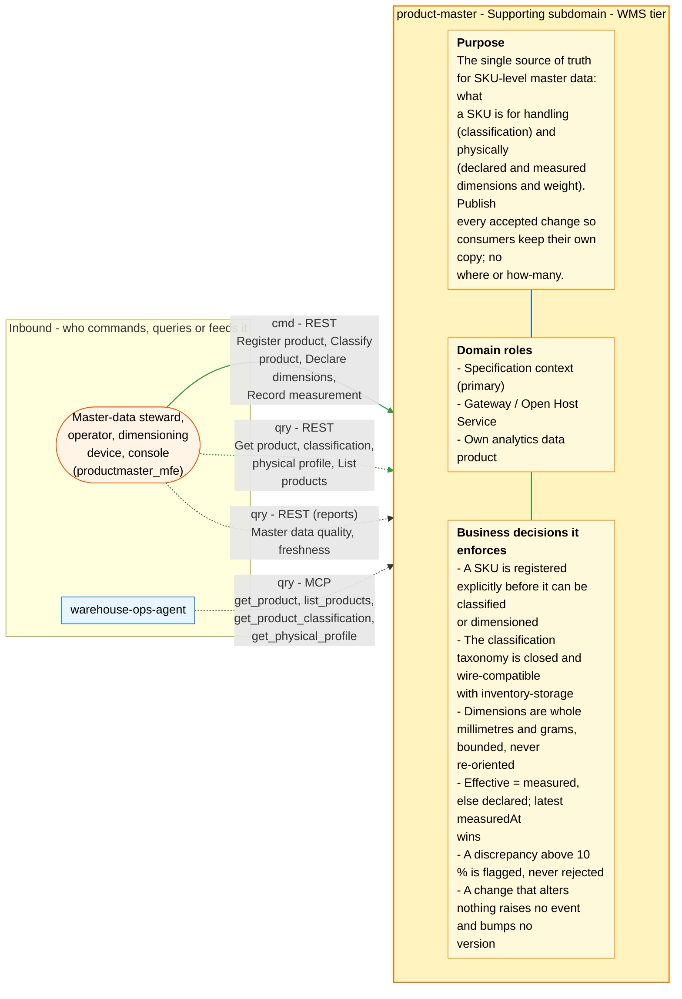
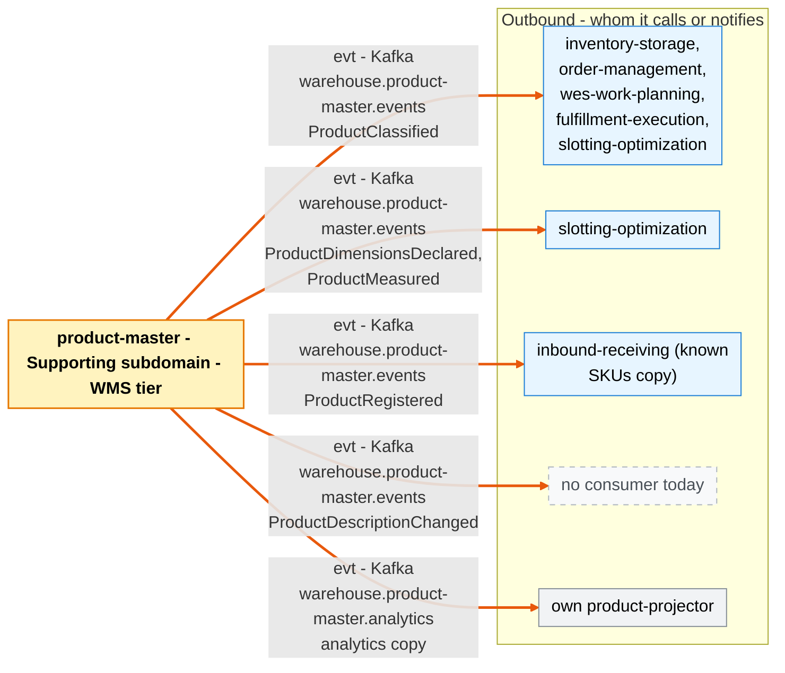

# Bounded context canvas

Following the ddd-crew [Bounded Context Canvas v5](https://github.com/ddd-crew/bounded-context-canvas).
Every message row below maps to a route in `NewRouter`
(`internal/adapters/inbound/http/server.go`), the reports router
(`internal/adapters/inbound/http/reports_handler.go`), an MCP tool
(`internal/adapters/inbound/mcp/tools.go`) or to a topic and CloudEvents type
in `internal/adapters/outbound/kafka/encoder.go`.

## Canvas at a glance

Two pictures of the sections below, laid out like the ddd-crew canvas:
first the inbound collaborators feeding this context (purpose, domain roles
and the business decisions it enforces), then the outbound collaborators it
calls or notifies. Arrows follow the message type: **solid blue**
commands (`cmd`), **dotted green** queries (`qry`), **thick orange** events
(`evt`); each arrow names its channel and the messages it carries. Box shapes
mark the collaborator kind: rounded = people, UI or any client; blue =
sibling bounded context; double border = external system or platform;
grey = this context's own projector, reports or dead-letter path; dashed =
published today with no consumer. Channel names on the arrows are
abbreviated (REST, MCP, Kafka, HTTP, port); the Inbound and Outbound
Communication tables carry the exact route, tool, topic and CloudEvents
type for every message.

### Inbound

### Outbound

Source: the Inbound Communication and Outbound Communication tables of this
page, which map to `internal/adapters/inbound/{http,kafka,mcp}` and `internal/adapters/outbound/`. The diagram omits assumptions, verification metrics, open
questions and the ubiquitous language (sections below), the relationship
pattern per message (OHS, ACL, Conformist, Customer/Supplier - see the
tables) and anything the tables mark as deprecated or platform-only
(health probes).

## Name

**Product Master** (`product-master`, Go module
`github.com/claudioed/product-master`, GitHub `IQVO/product-master`).

## Purpose

Be the single source of truth for SKU-level product master data: what a SKU
*is* for handling purposes (its classification) and physically (declared and
measured unit dimensions and weight). Publish every accepted change so the
contexts that act on these facts keep their own copy instead of asking at
request time. It answers no "where" or "how many" question (ADR 0001).

## Strategic Classification

| Axis | Verdict | Evidence |
| --- | --- | --- |
| Domain | **Supporting** | ADR 0001 "Classification"; see the [core domain chart](/docs/ddd/core-domain-chart) |
| Business model | **Compliance and risk reduction**: it earns nothing itself; it keeps hazmat, temperature and fragile handling correct in every downstream flow | the four consumers use the classification for stow placement and segregation, intake routing, release capabilities and seal-time segregation |
| Evolution | **Custom-built** (genesis) | Created 2026-10-06 (ADRs 0001-0004); the migration from inventory-storage finished with stage E on 2026-10-17 (ADR 0003): product-master is the only producer of classifications |

## Domain Roles

| Role | Applies? | Notes |
| --- | --- | --- |
| Specification context | **Yes** (primary) | Stewards and devices specify what a SKU is; others act on it. |
| Gateway / Open Host Service | **Yes** | REST plus the `warehouse.product-master.events` Published Language. |
| Execution context | No | It never moves goods or work. |
| Analysis context | No | No computation over sets; `Discrepancy` is a per-product flag. |
| Analytics / reporting | Yes (own data product) | `warehouse.product-master.analytics` -> `product-projector` -> analytical DB -> `product-reports` (`GET /reports/master-data-quality`, ADR 0006). |

## Inbound Communication

| Collaborator | Message | Type | Channel | Relationship |
| --- | --- | --- | --- | --- |
| Master-data steward / operator | Register product (or change its description) | Command | REST `PUT /products/{sku}` | This context is the OHS |
| Steward / operator | Classify product | Command | REST `PUT /products/{sku}/classification` | OHS |
| Steward / operator | Declare dimensions | Command | REST `PUT /products/{sku}/dimensions/declared` | OHS |
| Dimensioning device or operator | Record measurement | Command | REST `PUT /products/{sku}/dimensions/measured` | OHS |
| Operator, console, agent | Get product, classification, physical profile | Query | REST `GET /products/{sku}`, `/classification`, `/physical-profile` | OHS |
| Operator, console, agent | List products | Query | REST `GET /products` (filters `handlingTag`, `classified`) | OHS |
| `warehouse-ops-agent` | Get product, list products, get classification, get physical profile | Query | MCP (`cmd/mcp`) tools `get_product`, `list_products`, `get_product_classification`, `get_physical_profile` | OHS, read-only (ADR 0005); its ADR 0020 |
| `warehouse-console` (hosting `productmaster_mfe`) | All of the REST rows above | Command / Query | REST through Kong `/api/product-master` | OHS; the remote is this context's own code (`web/`) |
| Operator | Master data quality, freshness | Query | REST `GET /reports/master-data-quality`, `GET /reports/freshness` on `cmd/product-reports` (no console screen or agent uses it yet) | Own data product (ADR 0006) |

No Kafka event flows in: the ADR 0003 legacy classification importer (inventory-storage's
`com.warehouse.wms.inventory-storage.product.ProductClassified` on
`warehouse.inventory.events`) was removed at stage E, and inventory-storage
stopped publishing that type in the same stage. The only inbound Kafka consumer
in the repository is `cmd/product-projector`, which reads this context's own
analytics topic.

No REST endpoint or MCP tool is authenticated (fleet-wide revert of
2026-09-11). The MCP server is read-only: a governance test fails the build on
any write-verb tool name (ADR 0005).

## Outbound Communication

The context makes **no** synchronous call to any sibling and has no outbound
HTTP client (ADR 0001). Everything outbound leaves through the transactional
outbox and the relay in `cmd/api`.

| Collaborator | Message | Type | Channel | Relationship |
| --- | --- | --- | --- | --- |
| `inventory-storage`, `order-management`, `wes-work-planning`, `fulfillment-execution`, `slotting-optimization` | `ProductClassified` | Event | Kafka `warehouse.product-master.events`, `com.warehouse.wms.product-master.product.ProductClassified` | This context upstream, OHS + Published Language; each consumer keeps a version-guarded local copy. All five are built and wired in warehouse-infra (see the [context map](/docs/ddd/context-map)) |
| `inbound-receiving` (its `known_skus` local copy) | `ProductRegistered` | Event | same topic, `com.warehouse.wms.product-master.product.ProductRegistered` | OHS + PL |
| none today | `ProductDescriptionChanged` | Event | same topic, `...product.ProductDescriptionChanged` | OHS + PL |
| `slotting-optimization` (its product copy) | `ProductDimensionsDeclared` | Event | same topic, `...product.ProductDimensionsDeclared` | OHS + PL |
| `slotting-optimization` (its product copy) | `ProductMeasured` | Event | same topic, `...product.ProductMeasured` | OHS + PL |

## Ubiquitous Language

Full glossary with code identifiers: [Ubiquitous language](/docs/ddd/ubiquitous-language).
Top terms: **Product**, **SKU**, **Classification**, **Handling tag**,
**Temperature class**, **DOT hazard class**, **Classification source**,
**Unit dimensions**, **Declared**, **Measurement**, **Effective values**,
**Discrepancy**, **Version**, **Local copy**.

## Business Decisions

1. A SKU is registered explicitly before it can be classified or dimensioned;
   an attribute of an unknown SKU is `404`, never an implicit registration
   (ADR 0001).
2. The classification taxonomy is closed and its invariants are inherited
   unchanged from inventory-storage ADRs 0009/0010, so the wire contract stays
   field-compatible (ADR 0001, ADR 0004).
3. Dimensions are whole millimetres and grams, bounded 1..20000 mm and
   1..2000000 g, never normalised for orientation (ADR 0002).
4. Effective = measured, else declared; the latest measurement by
   `measuredAt` wins and an older one is rejected (ADR 0002).
5. A discrepancy above 10 % is flagged, never rejected (ADR 0002).
6. `Oversized` is a steward decision; nothing derives tags from dimensions
   (ADR 0002).
7. A change that alters nothing raises no event and bumps no version; every
   event carries the version after the change (ADR 0004).
8. Every classification is authored here (`native`); `legacy-import` survives
   only on rows the ADR 0003 importer wrote before stage E, and confirming one
   through `PUT /products/{sku}/classification` makes it `native`.
9. DOT segregation rules are applied by the contexts that co-locate goods,
   not here (ADR 0001).

## Assumptions

- `measuredAt` is supplied by the caller and trusted, except that it may not
  be after the service clock.
- One fixed 10 % discrepancy tolerance fits every product category (ADR 0002
  calls a per-category tolerance a later decision).
- Consumers can live with eventual consistency of classifications (ADR 0001,
  Consequences).

## Verification Metrics

- Golden exact-JSON tests per published type (`TestEncoder_GoldenWireFormat`,
  `internal/adapters/outbound/kafka/encoder_test.go`).
- `TestEventCatalogueMatchesContract` checks ADR 0004 against
  `apis/asyncapi.yaml`.
- The `mutation-fast` CI job (`make mutation`: gremlins on
  `./internal/domain/product`) is blocking; the coverage gate is 90 % over
  `internal/domain`, `internal/application` and `internal/analytics`.
- Outbox atomicity and relay delivery proven with testcontainers Postgres and
  Kafka (`TestUseCasesCommitProductAndOutboxAtomically`,
  `TestPgtx_CommitsSaveAndOutboxAtomically`,
  `TestWiring_RegisterClassifyMeasureLifecycle`,
  `TestRelay_RealPostgresAndKafka_PublishesCloudEventsKeyedBySKU`,
  `TestPublisher_RealKafka_CloudEventsEnvelopeAndPayload`); the REST and MCP wire contracts run against
  real Postgres too (`TestREST_*`, `TestStreamableHTTP_*`). See
  [Testing](/docs/development/testing).
- Migration (done): before stage E, ADR 0003's precondition was that every
  row of inventory-storage's `product_classifications` has a product-master
  product (`GET /products?classified=true`). It was verified before the
  importer was removed (ADR 0003, stage E executed 2026-10-17).
- One business counter is emitted over OTLP: `product_master.products.registered`, by `outcome` (`created`, `description_changed`, `unchanged`).

## Open Questions

- The physical profile has one consumer: slotting-optimization keeps a copy
  from `ProductDimensionsDeclared` and `ProductMeasured` (its ADR 0003). The
  uses ADR 0002 names are still unbuilt: no expected package weight in
  fulfillment-execution, no slot-volume check in inventory-storage, no
  cube-based capacity in warehouse-planning. Which comes next?
- Should measurement history be kept (ADR 0002, Consequences)?
- Should the discrepancy tolerance become per category?
- Pack hierarchy, units of measure, lifecycle states and barcodes are out of
  scope for v1 (ADR 0001); which comes first?
