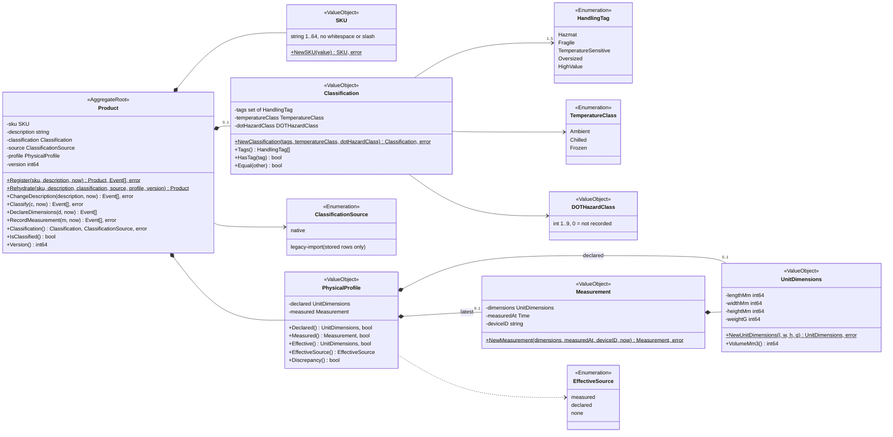
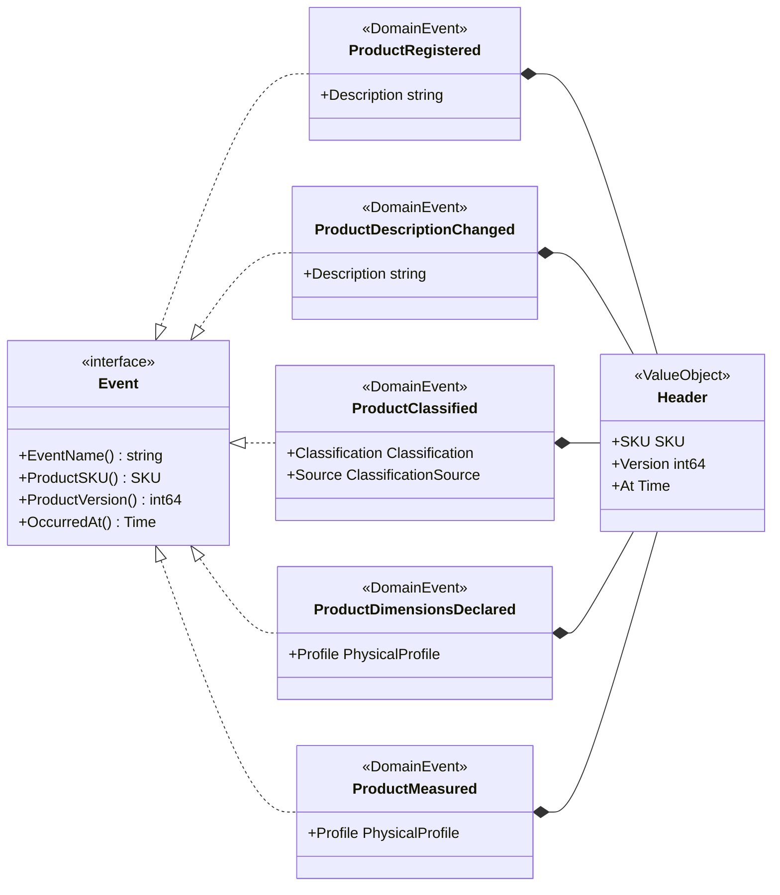
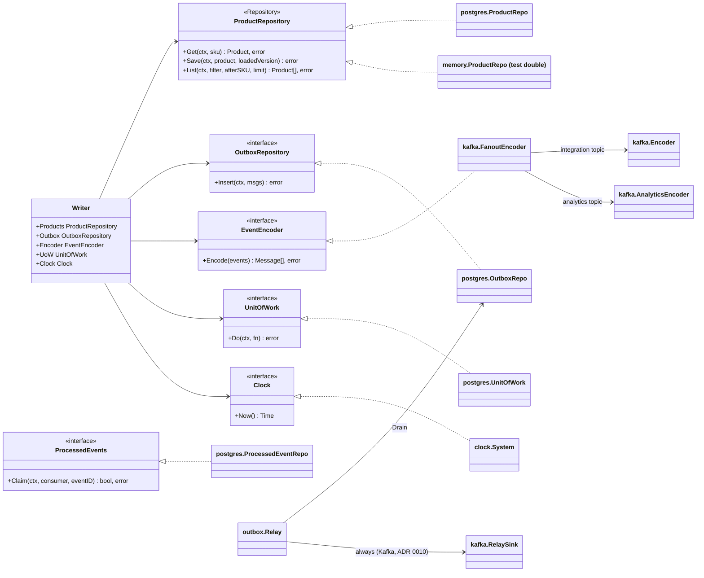
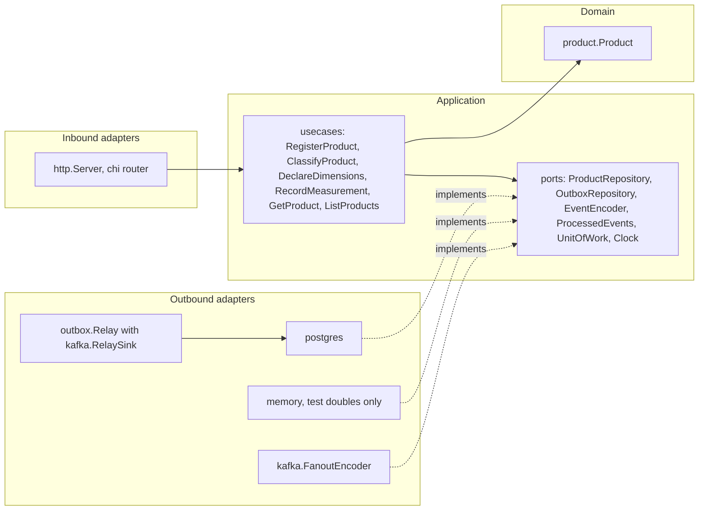

# Class diagrams

UML class diagrams of `internal/domain/product`, then the hexagonal ports and
the adapters that implement them. Field and method names are the real Go
identifiers (unexported fields keep their lower-case names); only
state-changing methods and the key queries are shown.

Stereotypes: `<<AggregateRoot>>`, `<<ValueObject>>`, `<<Enumeration>>`,
`<<DomainEvent>>` and `<<Repository>>` (an outbound port).

## Package `product`

Source: `internal/domain/product/product.go`, `classification.go`,
`physical.go`, `sku.go`. `legacy-import` is still a valid
`ClassificationSource` (`SourceLegacyImport`) because rows written by the
ADR 0003 importer keep it, but no method sets it since the importer was removed
at stage E: `Classify` always sets `native`.
Omits: the getters (`SKU()`, `Description()`, `LengthMm()` and so on), the
`Rehydrate*` helpers for persisted value objects, the parse functions
(`ParseHandlingTag`, `ParseTemperatureClass`, `ParseClassificationSource`) and
the sentinel errors (listed on the
[aggregate design canvas](/docs/ddd/aggregate-design-canvas)).

## Domain events

Source: `internal/domain/product/events.go`.
Omits: nothing; every event embeds `Header`, which supplies `ProductSKU`,
`ProductVersion` and `OccurredAt`.

## Ports and adapters

Source: `internal/application/ports/*.go`, `internal/application/usecases/writer.go`,
`internal/adapters/outbound/postgres/*.go`, `internal/adapters/outbound/memory/*.go`,
`internal/adapters/outbound/kafka/encoder.go`, `analytics_encoder.go`, `relay_sink.go`,
`internal/adapters/outbound/outbox/relay.go`, `internal/adapters/outbound/clock/clock.go`.
Omits: the in-memory `OutboxRepo`, `ProcessedEventRepo` and `UnitOfWork`
(same ports as their Postgres twins; test doubles only: no file under `cmd/`
imports `internal/adapters/outbound/memory`, enforced by
`TestRuntimeBinaryHasNoInMemoryAdapters`, ADR 0010), and the relay's `Store` /
`Sink` interfaces, which `postgres.OutboxRepo` and `kafka.RelaySink` (the only
sink) implement. `cmd/api` constructs `postgres.ProcessedEventRepo` but no use
case calls it since the legacy importer was removed (`cmd/api/adapters.go`).

## Hexagonal view

Source: `cmd/api/adapters.go` (`buildAdapters`, `buildServer`),
`cmd/api/relay.go` (`startOutboxRelay`), `internal/architecture/architecture_test.go`.
Omits: telemetry, readiness, the CloudEvents helper package and the other
binaries (`cmd/mcp` serves the read use cases over MCP; `cmd/product-projector`
and `cmd/product-reports` are the analytics read side, see
[Runtime](/docs/overview/runtime)).
