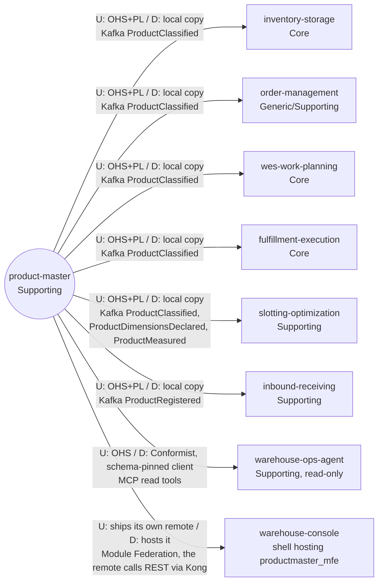

# Context map

This context's slice of the fleet map, following ddd-crew
[Context Mapping](https://github.com/ddd-crew/context-mapping). Every edge is
labelled `U` (upstream) / `D` (downstream) with the pattern on each side and
the technology. Every edge is live: built in both repositories on `develop`
and wired in the kind cluster (warehouse-infra `terraform/apps.yaml` and
`helm-values/`). There is no upstream context any more: the migration-only
edge from inventory-storage (ADR 0003 legacy importer) was removed at stage E.
Neighbour classifications come from the warehouse-docs subdomain
classification table.

Source: `docs/adr/0001-product-master-bounded-context.md` (Context map),
`docs/adr/0003-migration-from-inventory-storage.md` (stage E),
`docs/adr/0005-mcp-server-adoption.md`,
`internal/adapters/outbound/kafka/encoder.go`, `cmd/api/main.go`,
`cmd/mcp/main.go`, `web/vite.config.ts`; on the
consumer side (all on `develop`) inventory-storage
`internal/adapters/inbound/kafka/product_master_consumer.go`, order-management
and wes-work-planning `internal/adapters/inbound/kafka/product_classification_consumer.go`,
fulfillment-execution `internal/adapters/inbound/kafka/product_classified_consumer.go`,
slotting-optimization and inbound-receiving
`internal/adapters/inbound/kafka/product_consumer.go`,
warehouse-ops-agent `internal/adapters/outbound/mcpclient/product_master.go`,
warehouse-console `src/App.tsx` and `vite.config.ts` (`productmaster_mfe`).
Omits: the Kafka broker, Kong, the web gateway and the operators who call the
REST API directly.

## Relationships

| # | Upstream | Downstream | Patterns (U / D) | Technology | Status | Evidence |
| --- | --- | --- | --- | --- | --- | --- |
| 1 | `product-master` | `inventory-storage` | OHS + Published Language / local copy behind its own consumer (its existing `product_classifications` table, version-guarded) | Kafka `warehouse.product-master.events`, `com.warehouse.wms.product-master.product.ProductClassified` | **Live**: the consumer starts only when `PRODUCT_MASTER_CONSUMER_GROUP` is set; warehouse-infra sets it (`productMasterConsumerGroup: inventory-storage-product-master`) | inventory-storage ADR 0034, `product_master_consumer.go`, `cmd/inventory/productmaster.go` |
| 2 | `product-master` | `order-management` | OHS + PL / local copy behind the `ProductClassificationLookup` port | same type | **Live** with `PRODUCT_CLASSIFICATION_MODE=kafka` (binary default `permissive`; warehouse-infra sets `kafka`) | order-management ADR 0036, `cmd/order/product_classification.go` |
| 3 | `product-master` | `wes-work-planning` | OHS + PL / local copy | same type | **Live** with `PRODUCT_CLASSIFICATION_MODE=kafka` (binary default `permissive`; warehouse-infra sets `kafka` for `cmd/wes` and `cmd/mcp`) | wes-work-planning ADR 0035, `cmd/wes/classification.go` |
| 4 | `product-master` | `fulfillment-execution` | OHS + PL / local copy | same type | **Live**: `kafka` is the only mode (`permissive`, `off` and `http` are boot errors) and `PRODUCT_CLASSIFICATION_CONSUMER_GROUP` is required | fulfillment-execution ADR 0039, `cmd/execution/classification.go` |
| 5 | `product-master` | `slotting-optimization` | OHS + PL / local copy of the handling class and the effective unit size | `ProductClassified`, `ProductDimensionsDeclared`, `ProductMeasured` on the same topic | **Live**: `PRODUCT_MODE=kafka` is the only mode and `PRODUCT_CONSUMER_GROUP` is required | slotting-optimization ADR 0003, `cmd/api/main.go` (`consumerSpecs`) |
| 6 | `product-master` | `inbound-receiving` | OHS + PL / `known_skus` local copy (an ASN line for an unknown SKU is rejected) | `ProductRegistered` on the same topic | **Live**: `PRODUCT_MODE=kafka` is the only mode and `PRODUCT_CONSUMER_GROUP` is required | inbound-receiving ADR 0003, `cmd/api/main.go` |
| 7 | `product-master` | `warehouse-ops-agent` | Open Host Service (read-only MCP, ADR 0005) / Conformist: a schema-pinned client of the four read tools (`get_product`, `list_products`, `get_product_classification`, `get_physical_profile`); its `find_master_data_gaps` tool and `GET /master-data-gaps` page through `list_products` | MCP Streamable HTTP, `product-master-mcp:8090/mcp` (`PRODUCT_MASTER_MCP_ENDPOINT`) | **Live** and deployed; unset endpoint = feature off | warehouse-ops-agent ADR 0020, `cmd/mcp/main.go` |
| 8 | `product-master` | `warehouse-console` | this context ships its own UI, the `productmaster_mfe` Module Federation remote (`web/`); the console shell hosts it on `/product-master/*` behind a Product Master tile | Module Federation (`/mfes/product-master/`); the remote calls this context's REST API through Kong (`/api/product-master`) | **Live** and deployed | warehouse-console #66, `web/vite.config.ts`, `web/src/config.ts` |

`ProductDescriptionChanged` is the only published type with no consumer: every
consumer above ignores it by type.

There is no Shared Kernel and no Partnership: no sibling Go package is
imported, and the published payloads are the only shared contract.
`product-master` calls no sibling at request time, and no domain context calls
it at request time (ADR 0001); only the read-side Customers do (rows 7 and 8:
the ops-agent over MCP, the console remote over REST).
