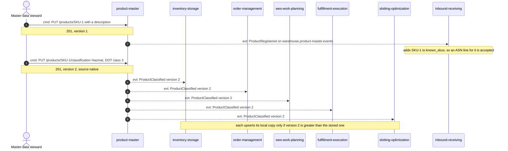
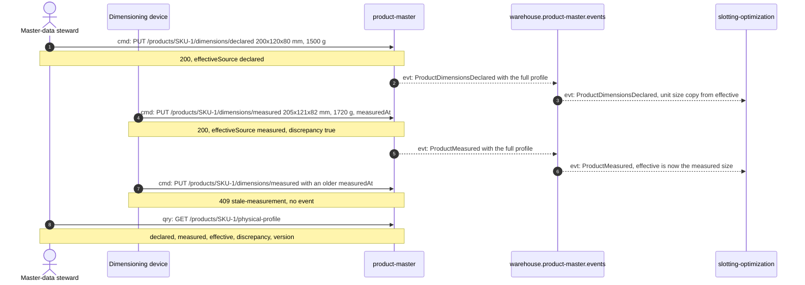
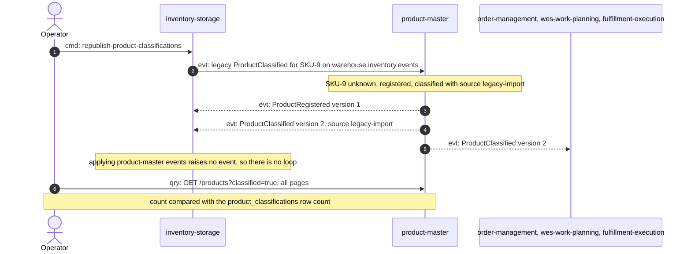

# Domain message flow

Following ddd-crew [Domain Message Flow Modelling](https://github.com/ddd-crew/domain-message-flow-modelling).
Each arrow is numbered and prefixed `cmd:` (command), `evt:` (event) or `qry:`
(query); replies are notes. Only real messages appear: REST routes from
`NewRouter` and CloudEvents types from the encoder and the consumers on each
sibling's `develop`. Section 3 is the record of the finished migration; its
importer no longer exists.

## 1. A steward classifies a SKU and every consumer updates its copy

Source: `internal/adapters/inbound/http/handlers.go`,
`internal/application/usecases/register_product.go`, `classify_product.go`,
`internal/adapters/outbound/kafka/encoder.go`; the six consumers listed on
[Downstream consumers](/docs/ecosystem/downstream-consumers).
Omits: the outbox relay hop between the commit and Kafka (one topic, the
fan-out is Kafka consumer groups), the analytics copy of each event, and the
consumers' mode switches (all set to `kafka` in warehouse-infra).

## 2. Declared, then measured, with a discrepancy

Source: `internal/application/usecases/physical_profile.go`,
`internal/domain/product/physical.go`, `product.go` (`RecordMeasurement`),
the `ProductMeasured` example in `apis/asyncapi.yaml`.
slotting-optimization `internal/adapters/inbound/kafka/product_consumer.go`
and its ADR 0003.
Omits: the other uses ADR 0002 names (expected package weight, slot volume at
stow, cube-based capacity): no sibling has built them.

## 3. Migration: legacy classifications flow in, product-master's flow out

Stage A and B of [ADR 0003](/docs/adr/0003-migration-from-inventory-storage):
the importer ran (`LEGACY_IMPORT_CONSUMER_GROUP` set) and an operator ran
inventory-storage's one-shot backfill command. Stage E was executed on
2026-10-17: the importer, its use case and `LEGACY_IMPORT_CONSUMER_GROUP` were
removed here (product-master #48), and inventory-storage removed the backfill
command and stopped publishing the legacy type (its commit 002852f, ADR 0034).
None of the code in the diagram below exists any more; it is the migration
record.

Source: `docs/adr/0003-migration-from-inventory-storage.md` (stages A to E and
the runbook) and inventory-storage ADR 0034. The deleted files were
`internal/adapters/inbound/kafka/legacy_importer.go` and
`internal/application/usecases/import_legacy_classification.go` here and
`cmd/inventory/republish.go` in inventory-storage.
Omits: a re-run of the backfill after the cutover (every message is then
either skipped because the classification is `native` or identical, so no
change), and the deduplication of a redelivered legacy message by its
CloudEvents id.
