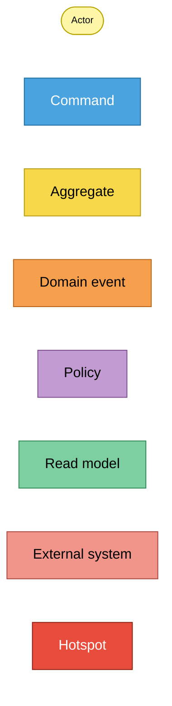
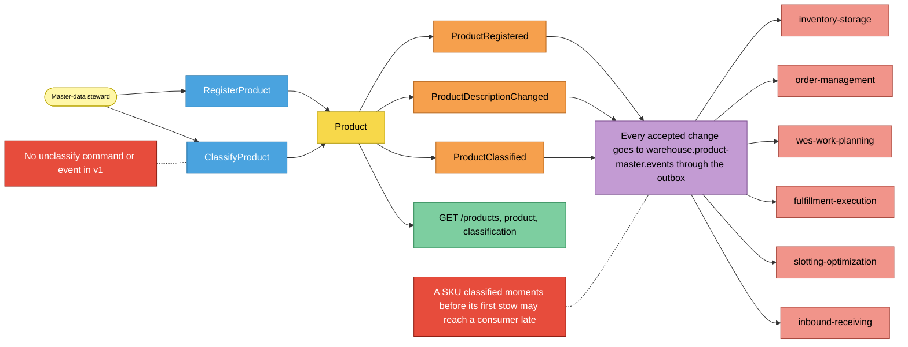
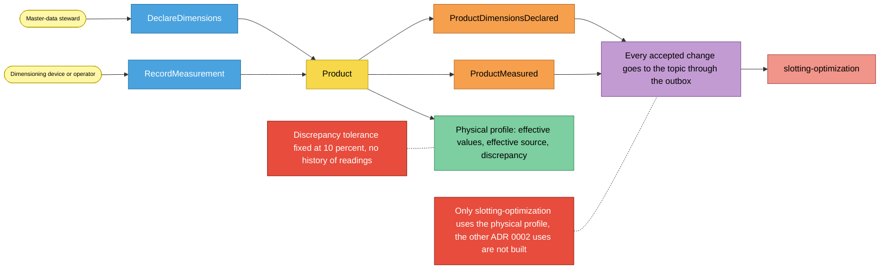

# EventStorming (design level)

Notation from the ddd-crew
[EventStorming glossary and cheat sheet](https://github.com/ddd-crew/eventstorming-glossary-cheat-sheet).
Two live processes and the record of the finished migration, each read left
to right. Hotspots are real, documented gaps
(ADRs, code comments), not invented ones.

## Legend

Source: ddd-crew cheat-sheet colours as specified for the fleet.
Omits: nothing; this is the key for the three diagrams below.

## 1. Register and classify a SKU

Source: `internal/application/usecases/register_product.go`,
`classify_product.go`, `writer.go`, `internal/domain/product/product.go`,
`internal/adapters/outbound/kafka/encoder.go`; ADR 0001 (Consequences:
eventual consistency).
Omits: the rejection paths (`400` slugs, `404 product-not-found`) and the
consumers' own policies. `ProductClassified` is consumed by the first five
externals, `ProductRegistered` by inbound-receiving only, and
`ProductDescriptionChanged` by nobody.

## 2. Declare and measure the physical profile

Source: `internal/application/usecases/physical_profile.go`,
`internal/domain/product/physical.go`, ADR 0002 (Consequences);
slotting-optimization `internal/adapters/inbound/kafka/product_consumer.go`.
Omits: `ErrStaleMeasurement` and `ErrMeasuredAtInFuture` (see the
[sequence diagrams](/docs/ddd/sequence-diagrams)).

## 3. Import legacy classifications (migration record, removed at stage E)

```mermaid
flowchart LR
  OP([Operator]):::actor --> X0[inventory-storage backfill command]:::external
  X0 --> E1[legacy ProductClassified]:::event
  INV[inventory-storage]:::external --> E1
  E1 --> P1[Whenever a legacy classification arrives, import it unless native]:::policy
  P1 --> C1[ImportLegacyClassification]:::command
  C1 --> A1[Product]:::aggregate
  A1 --> E2[ProductRegistered]:::event
  A1 --> E3[ProductClassified source legacy-import]:::event
  E3 --> P2[Every accepted change goes to the topic through the outbox]:::policy
  E2 --> P2
  P2 --> INV2[inventory-storage local copy]:::external
  H1[classificationSource legacy-import marks rows never reviewed here]:::hotspot -.- E3

  classDef actor fill:#fff7a8,stroke:#b8a400,color:#000,font-size:11px
  classDef command fill:#4aa3df,stroke:#1f6fa3,color:#fff
  classDef aggregate fill:#f7d84a,stroke:#b39b12,color:#000
  classDef event fill:#f6a04d,stroke:#b8661c,color:#000
  classDef policy fill:#c39bd3,stroke:#7d4f91,color:#000
  classDef readmodel fill:#7dcea0,stroke:#2f8a57,color:#000
  classDef external fill:#f1948a,stroke:#a9483e,color:#000
  classDef hotspot fill:#e74c3c,stroke:#8e1f14,color:#fff
```

Source: ADR 0003 (stages A, B, E and Consequences). The importer and
`ImportLegacyClassification` were removed at stage E (2026-10-17), and
inventory-storage no longer publishes the legacy type: nothing in this
diagram runs today. The `legacy-import` hotspot is still real for the rows the
importer wrote (`SourceLegacyImport` in `internal/domain/product/classification.go`).
Omits: the processed-event claim and the retry loop of the former importer.

## Sticky inventory

| Sticky | Kind | Code evidence |
| --- | --- | --- |
| Master-data steward, dimensioning device, operator | Actor | REST callers of `internal/adapters/inbound/http/handlers.go` |
| `RegisterProduct`, `ClassifyProduct`, `DeclareDimensions`, `RecordMeasurement` | Command | `internal/application/usecases/*.go` |
| `Product` | Aggregate | `internal/domain/product/product.go` |
| `ProductRegistered`, `ProductDescriptionChanged`, `ProductClassified`, `ProductDimensionsDeclared`, `ProductMeasured` | Domain event (published) | `internal/domain/product/events.go`, `internal/adapters/outbound/kafka/encoder.go` |
| Publish every accepted change through the outbox | Policy | `Writer.persist` in `writer.go`, `outbox.Relay` |
| Product, classification, physical profile, product list | Read model | `GetProduct`, `ListProducts` in `queries.go` |
| inventory-storage, order-management, wes-work-planning, fulfillment-execution, slotting-optimization, inbound-receiving | External system | their consumers of `warehouse.product-master.events` on `develop` |
| Late classification before first stow | Hotspot | ADR 0001, Consequences |
| No unclassify | Hotspot | `Product` has no method that removes a classification, and ADR 0004 lists no such event |
| Physical profile used by slotting-optimization only | Hotspot | ADR 0002, Consequences ("later phases"): no sibling consumes it for package weight, stow volume or cube capacity |
| Fixed 10 % tolerance, no measurement history | Hotspot | ADR 0002 rule 6 and Consequences |
| `legacy-import` rows never reviewed | Hotspot | ADR 0003, Consequences; `SourceLegacyImport` stays a valid stored value |
