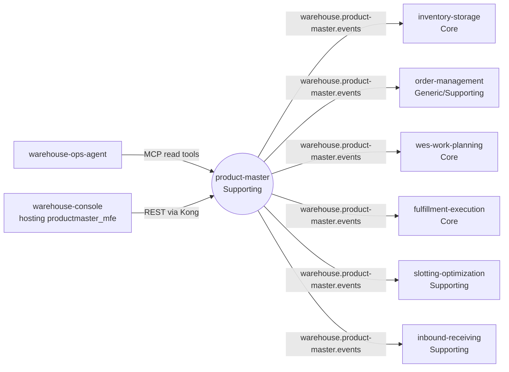

# Bounded context

## Purpose

`product-master` owns SKU-level product master data for the warehouse: what a
SKU *is* for handling purposes (its classification) and physically (its unit
dimensions and weight). Master-data stewards register SKUs, classify them and
declare their dimensions; dimensioning devices (or people with a tape and a
scale) record measurements. Every accepted change is published once, as a
CloudEvent, so the contexts that act on these facts keep their own copy.

Before this context existed, the only product facts in the fleet lived inside
`inventory-storage` (its ADRs 0009 and 0010), next to the stock ledger, and
three services read them live over REST. [ADR 0001](/docs/adr/0001-product-master-bounded-context)
moves ownership here because "what a SKU is" and "how many of it sit where"
change for different reasons, at different rates, by different people.

## Context map

Source: `docs/adr/0001-product-master-bounded-context.md` (Context map),
`docs/adr/0003-migration-from-inventory-storage.md` (stage E),
`internal/adapters/outbound/kafka/encoder.go`; on the consumer side each
sibling's consumer of `warehouse.product-master.events` on `develop`,
warehouse-ops-agent ADR 0020 and warehouse-console #66.
Omits: the Kafka broker, Kong, operators calling REST directly and the
patterns on each edge (see the [context map](/docs/ddd/context-map) for
those).

inventory-storage, order-management, wes-work-planning and
fulfillment-execution consume only `ProductClassified`; slotting-optimization
also consumes `ProductDimensionsDeclared` and `ProductMeasured`;
inbound-receiving consumes only `ProductRegistered`. Nothing flows in: the
legacy edge from inventory-storage (ADR 0003) was removed at stage E. See
[Downstream consumers](/docs/ecosystem/downstream-consumers).

## No live cross-context lookup, in either direction

- `product-master` never calls a sibling context. It has no outbound HTTP
  client at all; the only outbound adapters are Postgres and the Kafka relay
  sink.
- Downstream contexts do not call `product-master` at request time either.
  They keep a local copy built from the published events (full state per
  concern, keyed and partitioned by SKU, guarded by `version`). The REST `GET`
  endpoints and the read-only MCP tools exist for operators, the console and
  agents, not for service-to-service reads (ADR 0001, ADR 0005).

## Runtime surface

All four binaries ship in one image (`Dockerfile`); the console remote ships
in its own image (`web/Dockerfile`).

| Process | Role | Port |
| --- | --- | --- |
| `cmd/api` | REST API and the outbox relay | `:8080` (`HTTP_ADDR`) |
| `cmd/mcp` | MCP server, Streamable HTTP at `/` and `/mcp`, eight tools over the same database: six read-only and, since [ADR 0011](/docs/adr/0011-packaging-hierarchy-with-gs1-gtin), `declare_pack_level` and `retire_pack_level`, which enqueue their events in the outbox; no relay, no Kafka ([ADR 0005](/docs/adr/0005-mcp-server-adoption)) | `:8090` (`MCP_ADDR`) |
| `cmd/product-projector` | Consumes `warehouse.product-master.analytics` into the separate analytical database ([ADR 0006](/docs/adr/0006-analytics-read-side)) | admin `:8091` |
| `cmd/product-reports` | Read-only `GET /reports/master-data-quality` and `GET /reports/freshness` over the analytical database | `:8092` |
| `web/` (`productmaster_mfe`) | Module Federation remote mounted by the warehouse-console shell; calls the REST API | nginx; dev `:5191` |

`cmd/api` wires Postgres (running the embedded migrations first) and publishes
the outbox to Kafka; it exits at boot without `DATABASE_URL` or `KAFKA_BROKERS`
and has no in-memory or log-sink mode ([ADR 0010](/docs/adr/0010-postgres-and-kafka-are-the-only-runtime);
`cmd/api/{config,adapters,relay,main}.go`). See [Runtime and integration mechanics](/docs/overview/runtime).

### Deployed (kind cluster)

warehouse-infra deploys all of the above in the `warehouse-systems`
namespace (`terraform/apps.yaml`, `helm-values/product-master.yaml`): REST
through Kong at `http://localhost:8000/api/product-master`, the remote through
the web gateway at `http://localhost/mfes/product-master/`, the MCP server
in-cluster at `product-master-mcp:8090/mcp` (read by warehouse-ops-agent) and
through Kong at `/api/mcp/product-master`, and the projector and reports with
the `product_master_analytics` database.

The reports are routed by this chart's own HTTPRoute
(`charts/product-master/templates/reports-route.yaml`, rendered when
`analytics.enabled` and `analytics.reports.route.enabled`, both set in
warehouse-infra): `/api/product-master/reports` is rewritten to `/reports` on
Service `product-master-reports`. Its path prefix is longer than the API's
`/api/product-master`, so Gateway API precedence sends `/reports` requests to
it.

:::caution Reports through Kong: not re-verified
On 2026-10-07 warehouse-infra recorded a known issue: requests to
`/api/product-master/reports/*` were answered by the OLTP API route and
returned `404`. That was before the route moved into this chart and its
render condition was fixed (`8c22a05`, 2026-10-13). warehouse-infra's README
still lists the issue, and it has not been re-tested on a running cluster
since. If it returns `404`, reach the reports in-cluster with
`kubectl -n warehouse-systems port-forward svc/product-master-reports 8092:80`.
:::
